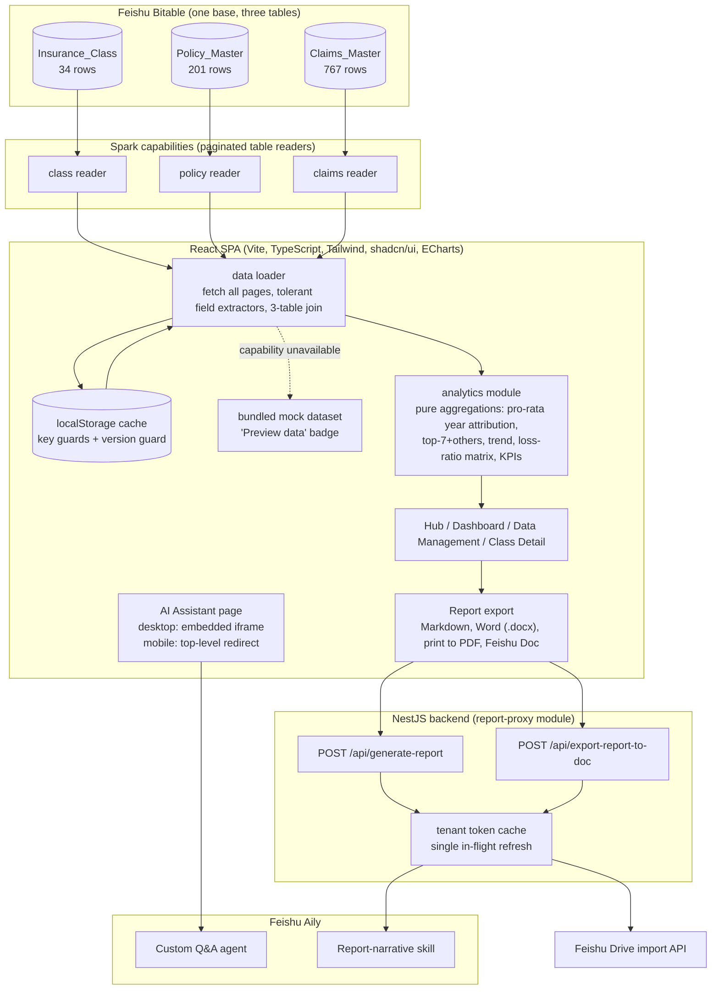
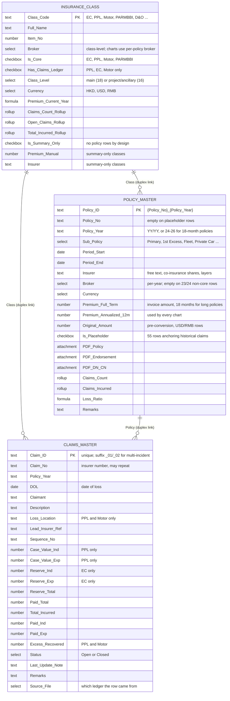

# Internal Insurance Program: a risk-management workspace inside Feishu

A case study of an internal tool built for the risk team of a utility company's corporate insurance programme. The company is deliberately not named, here or in the public demo, and no insurer or broker names appear anywhere; broker names are withheld in the demo (shown as a redaction bar; the broker chart keeps its slices and shares without labels). The numbers describing the dataset (row counts, baselines) are real.

## Context and problem

The company runs a corporate insurance programme of 34 classes of cover: employees' compensation (EC), public and products liability (PPL), motor fleet, a property all-risks and business-interruption policy (PARMBBI), and a long tail of directors' liability, cyber, marine cargo, group travel and project-specific policies.

Before this project the programme lived where corporate insurance usually lives: a yearly summary workbook from the broker, three claims ledgers (one spreadsheet per class that has claims), and folders of PDF policies, endorsements and debit notes.

The risk team's questions were easy to ask and slow to answer. What did we pay for EC in 25/26? When does the 18-month property policy really expire? Which motor claims are still open? What is the loss ratio per class per year? Each answer meant opening two or three files and doing arithmetic subtle enough (18-month policies, excess layers, placeholder years) that two people would arrive at two numbers.

The brief: one place for premiums, policy periods, claims, loss ratios and documents, plus an AI consultant that could answer those questions in chat and draft the narrative of the periodic insurance report.

## Constraints

- It had to live inside the company's Feishu workspace. No external hosting, no separate login, no data leaving the tenant.
- The data had to stay in Feishu Bitable (multi-dimensional tables) so that the risk team, who are not engineers, could keep maintaining it with tools they already use: add a policy row, attach a PDF, tick a checkbox.
- The app was built on Feishu Spark, the platform's low-code full-stack builder, which supplies the runtime (logging, identity, "capabilities" that wrap Bitable tables, a sandboxed NestJS backend) and constrains the code: no arbitrary outbound calls from the browser, and plugin instances whose field lists are fixed at creation.
- The AI had to be the tenant's own Aily agent, so that answers stayed inside the workspace's permissions.

## Architecture

**Frontend.** A React 19 + TypeScript single-page app (Vite, Tailwind v4, shadcn/ui, ECharts, react-router) with five routes: a Hub landing page, Dashboard, AI Assistant, Data Management (the class list), and a Class Detail page at `/data/class/:id` with tabs for policies (PDF badges, per-year insurer structure) and claims.

**Data layer.** Three Spark capabilities, one per Bitable table, each a thin paginated reader (`searchRecords`, 500 rows per page). The client fetches all three in parallel, parses every field through tolerant extractors, joins them into one in-memory structure (class, its policies, its claims) and caches the result in localStorage. Every aggregation is a pure function over that structure: premium by class, by broker, the four-year trend, claims by year, incurred by class, the loss-ratio matrix and dashboard KPIs.

**Backend.** A small NestJS module with two endpoints. `POST /api/generate-report` calls an Aily skill once per report section and stitches the returned Markdown. `POST /api/export-report-to-doc` turns that Markdown into a Feishu Doc through the Drive import API. The backend holds the app secret (from the platform's connections SDK, with env vars as fallback), caches the tenant access token, and is the only component that talks to the Feishu open API.

**AI.** Two separate Aily surfaces: a custom agent for Q&A, embedded through the Aily Web SDK, and a skill under an Aily application that writes report sections from a structured JSON payload.

## Data model

Three tables in one Bitable base, joined through duplex links. **Insurance_Class** (34 rows) is the master list keyed by `Class_Code`, with Bitable-computed rollups and, for three "summary-only" classes, a hand-entered premium and insurer. **Policy_Master** (201 rows) is one row per policy per year, keyed by `{Policy_No}_{Policy_Year}`, with period dates on every row, two deliberate premium columns (`Premium_Full_Term` is the invoice, `Premium_Annualized_12m` is what every chart uses) and three PDF attachment fields. **Claims_Master** (767 rows: 127 PPL, 263 Motor, 377 EC) is one row per claim; `Claim_ID` is unique, the insurer's `Claim_No` is not, and every claim links to both a class and a policy row with zero dangling links.

### Data quirks the model had to absorb

The source data is real-world messy, and the model's job is to carry that mess without hiding it:

- The property policy is a chain of back-to-back 18-month policies with labels like `24-26`. A handover year receives six months from each policy in the chain.
- 55 placeholder rows exist only so that historical claims (back to 2012) have a policy to attach to. They have no premium and no PDF, count for claims statistics, and are excluded from every premium figure.
- PPL is written in layers: the premium sits on the Primary row and the Excess rows carry zero by design. Motor premium is consolidated on the Fleet row. Group Travel has no fixed premium at all (declaration basis). None of these zeros are missing data.
- One year has two PPL primary policy numbers side by side; both are real.
- Some rows run 1 January to 31 December, not the April-to-March programme year.
- Three summary-only classes have no policy rows; premium and insurer are typed at class level.
- 23/24 non-core rows have an empty broker because the source file had no broker column. They appear as a named "Unknown (2023 file)" slice in the broker chart instead of vanishing.
- Claim numbers repeat, and three PPL claims have a date of loss outside their policy period. Both are faithful to the ledgers, not bugs.
- A few policies are priced in USD or RMB (stored HKD-converted, original amount alongside), and some select values are Chinese labels the app maps to English.

## Key engineering decisions

**1. Client-side join and localStorage cache, not server queries.**
Alternative: a NestJS endpoint per page that queries Bitable and returns aggregates. Chosen because the whole dataset is about a thousand rows, every page needs cross-table aggregation, and the capabilities are plain table readers with no join support. Fetch once, join in the browser, cache, and every page mounts instantly; a Sync button forces a fresh pull.

**2. Pro-rata monthly attribution of premium to policy years.**
The original handoff rule was "if a policy overlaps year N, count its full annualised premium in N". With the 18-month property chain that double-counts handover years by roughly one full policy (about 13M HKD too high in 24/25). The shipped rule: share of year N = annualised premium times overlapping whole months divided by 12. April-aligned 12-month policies are unaffected; the chain contributes 6/12 plus 6/12 in a handover year; a calendar-year row splits 3/12 and 9/12. Missing period dates fall back to exact `Policy_Year` matching so the chart still renders.

**3. Two premium "calibers", both explicit.**
Pro-rata attribution is right for charts and loss ratios, but wrong for the class list and the detail-page chip, where the user expects the number to equal the rows visible in the policies table. Those use a label-match caliber (rows whose `Policy_Year` normalises to the selected year, full annualised premium each). The two functions sit side by side with comments saying which page uses which.

**4. Cache guards by key and by version.**
Alternative: a TTL, which would not have caught the actual failure: after the base gained three new columns, old caches had every key present with default values and passed the key-presence guard. The cache now has two layers, a key-presence guard for the shape and a `STORAGE_VERSION` string bumped whenever the plugin's field set changes. The mock dataset is never written to the cache, so a preview session cannot poison real data.

**5. Tolerant field extractors.**
Bitable returns different shapes for the same logical value depending on field type and plugin version: plain strings, `{text}`, `{value}`, arrays of `{text}`, `{link_record_ids: []}`, timestamps or ISO strings for dates. One extractor per logical type accepts all of them, and field names live in one constants file shared by the capability JSON and the parsers.

**6. A loader that never throws.**
The loader goes cache, then capability, then bundled mock, and returns a `dataSource` flag, so outside Spark (local development, the public demo) every page renders under a "Preview data" badge instead of a blank screen. A dev-time check logs the computed totals after each load for comparison with the handoff numbers.

**7. A server-side proxy for Aily, because the browser cannot call it.**
Tested and ruled out: calling the Feishu open API from the frontend. The preflight request returns 404 with no CORS headers, and exchanging a token needs the app secret. The proxy caches the tenant access token with a five-minute safety margin and a single in-flight refresh promise, and retries once when Aily reports an expired token. (One NestJS snag: the platform module does not export `HttpModule` globally, so the business module imports it itself.)

**8. One skill call per section, in parallel, with `allSettled`.**
Alternative: one call for the whole report. Aily enforces a hard 60-second timeout per call, and a whole-report prompt drifted in structure. Each section is a separate call with its own instruction; failures are collected, shown in place as "this section failed, retry", and named in a warning toast.

**9. A mobile fallback for the AI iframe.**
The Aily Web SDK embeds a cross-origin iframe. On iOS, WebKit's storage partitioning stops the agent session inside a third-party iframe, and the SDK resolves after a 30-second wait instead of rejecting, so the host page cannot even detect the failure. Desktop keeps the embed behind a 15-second `Promise.race`. Mobile skips the SDK and does a top-level `location.replace` to the same agent URL, which works, and writes no history entry so the back button cannot loop.

**10. One entry point for per-class premium.**
Summary-only classes have no policy rows, so any aggregation written as "sum over policies" silently drops them. Two wrapper functions are the only ones pages may call; they return the class-level manual premium for the current year (zero otherwise) and defer to the policy-row functions for everything else.

## AI integration

**Q&A agent.** The Assistant page embeds the tenant's Aily custom agent with `initAgentChat` and a channel token. Its grounding on the three tables (data sources, suggested questions) is configured in the Aily console, not in this codebase; the code's job is to host the chat reliably on desktop and mobile. Suggested questions were of the form "What is the EC premium for 25/26?", "What is the current policy period for PARMBBI?", "Which Motor claims are open?".

**Report-narrative skill.** The Export Report dialog lets the user choose a report year, a trend range, any of five sections (Premium by Class, Premium by Broker, Premium Trend, Loss Ratio, Claims Overview) and free-text notes. The payload is built from the aggregates already on screen; nothing is re-queried. Every row with a class code also carries its full name, so the model cannot invent an expansion, and every table carries a note stating the pro-rata caliber.

The server sends one call for the executive summary and one per section. Each carries an instruction that pins the output shape: one H2 heading, one paragraph, one table, numbers without repeated units, English only. The loss-ratio instruction adds an IBNR caveat and marks the two most recent years "Developing" so the model does not read an immature low ratio as improvement. The executive-summary instruction forbids comparing all-years incurred (since 2012) with current-year premium, two numbers a naive summary happily divides.

The client then splits the returned Markdown on H2 headings, matches each section by a title regex, and re-inserts the live dashboard chart between the paragraph and the table. The chart the reader sees is rendered from the same data the model was given.

**Exports.** Copy or download Markdown; download Word, with the three premium charts rendered off-screen by ECharts to 2x PNG (blank-canvas check, one retry) and embedded as numbered figures, tables rebuilt in `docx`; print to PDF through a stylesheet that isolates the report root; and Save to Feishu Docs (upload, import task, poll, transfer ownership). The mobile share flow degrades from `navigator.share` to the clipboard to a manual copy field.

## Outcomes

- Three Bitable tables (34 classes, 201 policy rows, 767 claims) consolidate the workbook, three ledgers and PDF folders into one maintained source, with PDFs attached to their policy rows.
- Five routes: Hub, Dashboard (six chart or table sections plus year slicers), AI Assistant, Data Management, Class Detail.
- Report export in four formats: Markdown, Word with embedded charts, PDF via print, and a Feishu Doc with a shareable link.
- Baseline reconciliation: with real data bound, the logged totals (767 claims, 68 open, per-class incurred) match the ledgers to the cent, and the 26/27 premium trend point of 31.08M HKD matches the broker summary.
- Type-check and lint clean at handoff.
- [TO FILL: adoption / time saved / who uses it weekly. Ask Alex.]

## What I'd do differently

- Put the annualisation rule in the base as well as in code: a per-row "months in year N" helper column would let the risk team audit the chart against the table without reading TypeScript.
- Version the capability field list in the repo and check it at load time. The plugin-field gotcha (a base column added, the instance not updated, correct code reading nothing) cost real debugging time and was found by counting fields in a browser log.
- Move the per-section prompt text out of the service into a versioned file with test fixtures. The instructions are the most-edited part of the backend and the least tested.
- Drop `html-to-image`. It is in the dependency list, but the shipped chart capture uses ECharts' own `getDataURL`, which is faster and does not fight the sandbox.
- Decide earlier that the mobile assistant would be a redirect. Real effort went into making the iframe work on iOS before the SDK's silent-resolve behaviour was understood.

## Demo notes

The public demo is the same frontend built standalone with Vite, with a local shim standing in for the Spark runtime. Real: all five pages, the data layer and its cache guards, every aggregation, the mobile layouts, and the Markdown, Word and print exports.

What the demo shows instead of the production data, and how it says so:

- **Aggregates are synthetic and labelled.** The capabilities always reject in the shim, so the app runs on a bundled dataset (about 30 classes, a few dozen policies and claims) under a "Preview data" badge. Every chart, KPI, premium per class or year, loss ratio and claim count is computed by the real analytics code from synthetic amounts, and the surfaces carry a "Synthetic data" label. The dataset reproduces every quirk listed above (18-month chains, placeholder rows, excess layers, calendar-year rows, the unknown-broker slice, repeated claim numbers, out-of-period loss dates).
- **Record-level fields are redacted, not invented.** Policy numbers, insurer names, claimants, claim numbers, descriptions, loss locations, PDF file names and remarks are stored as a redaction sentinel and rendered as a grey "Redacted for public demo" bar wherever a table or detail view would show them. Broker names are withheld the same way; the Premium by Broker chart keeps its slices and share percentages but no labels.
- **Unavailable features say so.** Bitable sync, deep links into the base, the AI report narrative and Save to Feishu Docs all needed the Feishu runtime or the backend. Each shows an explicit "Not available in public demo" state (a disabled control, a notice, or a toast) instead of a fake substitute. Report generation merges a canned narrative, marked as simulated, with tables rebuilt from the dashboard snapshot so the numbers always match the screen.
- **The AI Assistant is a visual replica.** The page reproduces the embedded Aily panel (layout, suggested questions, input) so the interaction can be seen, but no model is behind it: any message returns a "Not available in public demo" notice, never a fabricated answer.
- **No company name.** The programme is called "Internal Insurance Program" throughout; the report is titled "Internal Insurance Report".
