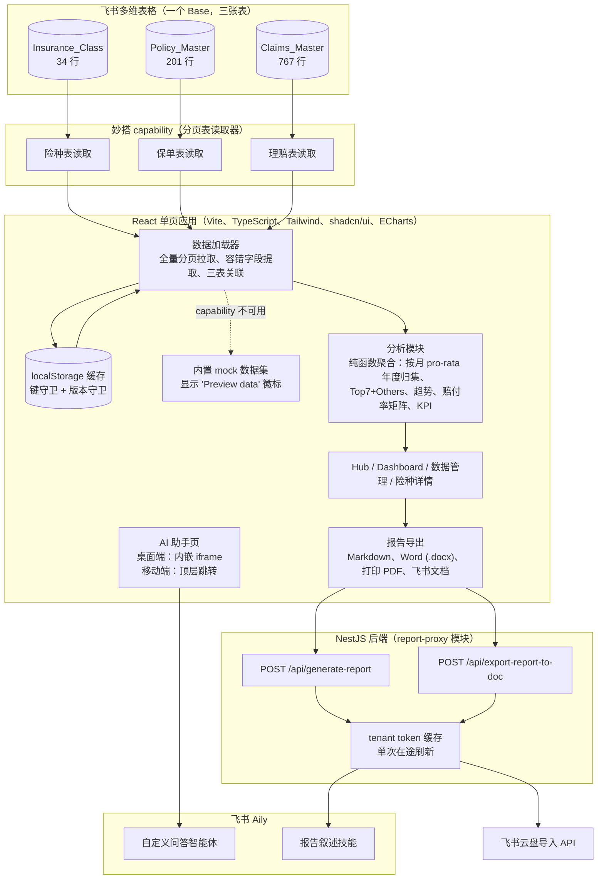
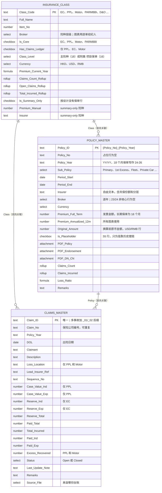

# Internal Insurance Program：在飞书里给风险管理团队做的一站式保险工作台

本文记录一个为某公用事业公司风险管理团队开发的内部工具。文中和公开 demo 里都刻意不出现公司名称，也不出现任何保险公司或经纪人的名字，经纪人名称在 demo 中同样遮蔽（图表保留切片和占比，不显示标签）；描述数据集的数字（行数、基准值）是真实的。

## 背景与问题

这家公司的企业保险计划有 34 个险种：雇员补偿（EC）、公众及产品责任（PPL）、车队（Motor）、财产一切险及营业中断（PARMBBI），再加上一长串董责、网络安全、海运货物、团体旅游和项目专属保单。

在这个项目之前，这套保险计划"住"在企业保险通常住的地方：经纪人每年给的汇总工作簿、三份各自独立的理赔台账（有理赔的险种一个 Excel）、以及一堆保单、批单、付款通知的 PDF。

风险团队的问题问起来简单，答起来慢。25/26 年度 EC 交了多少保费？财产险实际什么时候到期，考虑到它是 18 个月一期的？哪些车险理赔还没结案？各险种各年度的赔付率是多少？每个答案都要打开两三个文件手工算，而这些算法又足够微妙（18 个月保单、超赔层、占位年份），两个人算往往会得出两个数。

需求归纳成一句话：一个地方看保费、保单期间、理赔、赔付率和文件，再加一个 AI 顾问，能在聊天里回答这些问题，并且帮忙起草定期保险报告的文字部分。

## 约束

- 必须放在公司的飞书工作区里。不能外部托管，不能单独登录，数据不能离开租户。
- 数据必须留在飞书多维表格（Bitable）里，风险团队不是工程师，要能用他们已经熟悉的方式继续维护：加一行保单、挂一个 PDF、勾一个复选框。
- 应用基于飞书妙搭（Spark）这个低代码全栈平台构建。平台提供运行时（日志、身份、封装 Bitable 表的"capability"、沙箱化的 NestJS 后端），也带来限制：浏览器不能随意对外发请求，插件实例的字段清单在创建时就固定了。
- AI 必须用租户自己的 Aily 智能体，回答才不会越过工作区的权限边界。

## 架构

**前端。** React 19 + TypeScript 单页应用（Vite、Tailwind v4、shadcn/ui、ECharts、react-router），五个路由：Hub 门户页、Dashboard、AI 助手、数据管理（险种列表，支持搜索和分组）、险种详情页 `/data/class/:id`（保单 tab 含 PDF 徽标和逐年承保结构，理赔 tab）。

**数据层。** 三个妙搭 capability，一张表一个，都是很薄的分页读取器（`searchRecords`，每页 500 行）。客户端并行拉三张表，每个字段都经过容错提取器解析，在内存里关联成一个结构（险种、它的保单、它的理赔），结果缓存进 localStorage。所有聚合都是对这个结构的纯函数：按险种、按经纪人的保费，四年趋势，按年度的理赔件数，按险种的已发生损失，赔付率矩阵，Dashboard KPI。

**后端。** 一个小 NestJS 模块，两个接口。`POST /api/generate-report` 按报告板块逐个调用 Aily 技能，再把返回的 Markdown 拼起来。`POST /api/export-report-to-doc` 通过云盘导入 API 把 Markdown 变成飞书文档。后端持有 app secret（优先从平台的凭据 SDK 取，环境变量兜底），缓存 tenant access token，是唯一和飞书开放平台通信的组件。

**AI。** 两个独立的 Aily 入口：一个自定义智能体负责问答，通过 Aily Web SDK 嵌入；一个挂在 Aily 应用下的技能，根据结构化 JSON 输入撰写报告板块。

## 数据模型

一个 Base 里三张表，靠双向关联字段连起来。

**Insurance_Class**（34 行）是主表，主键 `Class_Code`。它带着险种层级的属性、由 Bitable 自己算的 rollup（理赔件数、未结件数、已发生损失合计、当年保费公式），以及三个"summary-only"险种手填的保费和承保人。

**Policy_Master**（201 行）一行是一张保单的一个年度，主键 `{Policy_No}_{Policy_Year}`，每行都有 `Period_Start` 和 `Period_End`。两个保费列是有意为之的：`Premium_Full_Term` 是发票金额（长期财产险是 18 个月的数），`Premium_Annualized_12m` 是所有图表用的年化数。三个附件字段分别放保单、批单、付款/退款通知的 PDF。

**Claims_Master**（767 行：PPL 127、Motor 263、EC 377）一行一个理赔。`Claim_ID` 唯一；`Claim_No` 是保险公司的编号，会重复。每个理赔同时关联险种和保单行，导入后零悬空。金额列按险种不同：PPL 有案值，EC 有准备金，三者都有已付和已发生合计。

### 模型必须容纳的数据怪癖

源数据是真实世界的那种乱，模型的任务是把这种乱原样带着，而不是藏起来：

- 财产险是一串首尾相接的 18 个月保单，年度标签写作 `24-26` 这种。交接年份从前后两张保单各拿六个月。
- 55 行占位保单只为了让 2012 年以来的历史理赔有地方挂。它们没有保费也没有 PDF，计入理赔统计，从任何保费数字里排除。
- PPL 是分层承保的：保费记在 Primary 行，超赔层各行保费为零是设计如此。车险保费合并在 Fleet 行。团体旅游根本没有固定保费（按申报计费）。这些零都不是缺数据。
- 某一年度 PPL 同时有两张主保单号并列，两行都是真的。
- 有些行的期间是 1 月 1 日到 12 月 31 日，不是 4 月起的保单年度。
- 三个 summary-only 险种没有保单行，保费和承保人在险种层级手填。
- 23/24 年度非核心行的经纪人为空，因为源文件没有这一列。它们在经纪人图里显示为命名的"Unknown (2023 file)"分片，而不是消失。
- 理赔编号会重复；三个 PPL 理赔的出险日期落在保单期间之外。两者都是台账原样，不是 bug。
- 少数保单以美元或人民币计价，金额按港币换算存储，原币金额并排保留。
- 险种层级和部分单选值是中文标签，应用展示时映射成英文。

## 关键工程决策

**1. 客户端关联 + localStorage 缓存，而不是服务端查询。**
备选方案：每个页面一个 NestJS 接口，查 Bitable 再返回聚合结果。选前者是因为整个数据集大约一千行，每个页面都需要跨表聚合，而 capability 只是平的表读取器，不支持关联。一次拉全量、浏览器里关联、缓存起来，之后每个页面从缓存瞬时挂载。Sync 按钮强制重新拉取。

**2. 保费按月 pro-rata 归集到保单年度。**
最初交接的规则是"保单只要和年度 N 有重叠，就把整个年化保费算进 N"。碰上 18 个月的财产险链，交接年份会多算差不多一整张保单（24/25 高出约 1300 万港币）。上线的规则：年度 N 的份额 = 年化保费 × 重叠整月数 ÷ 12。4 月对齐的 12 个月保单不受影响；保单链在交接年贡献 6/12 加 6/12；自然年的行拆成 3/12 和 9/12。期间日期缺失时退化为 `Policy_Year` 字符串精确匹配，图表照样能画出来。

**3. 两种保费"口径"，并且都摆在明面上。**
pro-rata 归集对图表和赔付率是对的，但对险种列表和详情页的数字卡是错的，用户期望那里的数字和他在保单表里看到的行加起来一样。这两处用标签匹配口径（`Policy_Year` 归一化后等于所选年度的行，每行取完整年化保费）。两个函数并排放着，注释写清哪个页面用哪个。

**4. 缓存同时按键和按版本守卫。**
备选方案：TTL。TTL 抓不住实际发生的故障：Base 新增三列之后，旧缓存每个键都在（只是默认值），键存在守卫通过了。现在缓存有两层：键存在守卫管形状，`STORAGE_VERSION` 字符串在插件字段集变化时必须升版本。mock 数据永远不写进缓存，预览会话不会污染真实数据。

**5. 容错的字段提取器。**
同一个逻辑值，Bitable 会因字段类型和插件版本返回不同形态：纯字符串、`{text}`、`{value}`、`{text}` 数组、`{link_record_ids: []}`、日期是时间戳或 ISO 字符串。每个提取器（`extractText`、`extractNumber`、`extractDate`、`extractLinkIds`、`extractFiles`）都接受全部形态。字段名集中在一个常量文件，capability JSON 和解析器都引用它。

**6. 一个永远不抛错的加载器。**
加载器依次走缓存、capability、内置 mock，并返回一个 `dataSource` 标记。在妙搭之外（本地开发、公开 demo）每个页面都能渲染，带"Preview data"徽标，而不是白屏。开发态的基准自检在每次加载后打印计算出来的合计，方便和交接文档的数字对照。

**7. Aily 走服务端代理，因为浏览器调不了。**
实测排除了前端直调飞书开放平台：预检请求返回 404 且没有 CORS 头，换 token 又需要 app secret。代理缓存 tenant access token，留五分钟安全余量，同一时刻只有一个刷新 promise 在途，Aily 返回 token 过期错误码时重试一次。一个值得记下的 NestJS 细节：平台模块没有全局导出 `HttpModule`，业务模块要自己显式引入。

**8. 每个板块单独调一次技能，并行，用 `allSettled`。**
备选方案：整份报告一次调用。Aily 每次调用有 60 秒硬超时，而整份报告的 prompt 输出结构会漂。现在每个板块是一次独立调用，带板块专属指令；失败的板块被收集起来，报告里原位显示"本节生成失败，可重试"，板块名返回给前端弹警告 toast。

**9. AI iframe 的移动端兜底。**
Aily Web SDK 嵌的是跨域 iframe。iOS 上 WebKit 的存储分区让智能体会话在第三方 iframe 里跑不起来，而 SDK 等 30 秒之后是 resolve 而不是 reject，宿主页面连失败都感知不到。桌面端保留嵌入，加 15 秒 `Promise.race` 超时切错误态。移动端不初始化 SDK，直接 `location.replace` 顶层跳到同一个智能体 URL，这样能用；用 `replace` 而不是 `assign`，返回键才不会死循环。

**10. 险种保费只有一个入口。**
summary-only 险种没有保单行，任何写成"对保单求和"的聚合都会悄悄把它们丢掉。页面只允许调用两个包装函数：当年返回险种层级的手填保费，其他年份返回零，其余情况再转给保单行函数。

## AI 集成

**问答智能体。** 助手页用 `initAgentChat` 和一个 channel token 嵌入租户的 Aily 自定义智能体。智能体对三张表的知识（数据源、推荐问题）配置在 Aily 控制台，不在这个代码库里；代码的职责是在桌面和移动端把聊天面可靠地承载起来。交接文档建议的推荐问题形如"EC 25/26 保费多少？""PARMBBI 现在的保单期间？""Open 的 Motor 理赔有哪些？"。

**报告叙述技能。** 导出报告对话框让用户选报告年度、趋势区间、五个板块（按险种保费、按经纪人保费、保费趋势、赔付率、理赔概览）的任意组合，以及自由文本备注。载荷直接从页面上已经算好的聚合结果组装，不重新查询。每一行只要带险种代码就同时带全称，模型无法给缩写编一个错的展开。每张表都带一条说明 pro-rata 口径的注释。

服务端为执行摘要发一次调用，每个板块再各发一次。每次调用带一条固定输出形状的指令：一个二级标题、一段文字、一张表，数字不重复单位，无论数据里的标签是什么语言都用英文写。赔付率的指令额外加了 IBNR 提示，把最近两个年度标为"Developing"，防止模型把尚未成熟的低赔付率解读为风险改善。执行摘要的指令禁止把 2012 年以来的累计损失和当年保费做比较，这两个数一个天真的摘要会很乐意拿来相除。用户备注附加到每个板块的指令末尾。

前端把返回的 Markdown 按二级标题切开，用标题正则匹配板块，把 Dashboard 上的实时图表重新插到段落和表格之间。读者看到的图和模型拿到的数据同源。

**导出。** 复制 Markdown；下载 `.md`；下载 Word，三张保费图由 ECharts 在屏幕外以 2 倍像素渲染成 PNG，检查空白画布并重试一次，作为编号图表嵌入，表格用 `docx` 重建；通过隔离报告根节点的打印样式表打印成 PDF；保存到飞书文档，即上传 Markdown、创建导入任务、轮询、把所有权转给配置的负责人。移动端的分享流程从 `navigator.share` 降级到剪贴板再到手动复制框。

## 成果

- 三张 Bitable 表（34 个险种、201 行保单、767 个理赔）把汇总工作簿、三份台账和 PDF 文件夹收拢成一个持续维护的数据源，PDF 挂在它们所属的保单行上。
- 五个路由：Hub、Dashboard（六个图表或表格板块加年度切换器）、AI 助手、数据管理、险种详情。
- 报告导出四种格式：Markdown、内嵌图表的 Word、打印 PDF、带分享链接的飞书文档。
- 基准核对：绑定真实数据后，应用打印的理赔总数 767（未结 68）和各险种已发生损失合计与台账分毫不差，26/27 年度保费趋势点 3108 万港币与经纪人汇总一致。
- 交付时类型检查和 lint 全绿。
- [待填：使用率 / 节省的时间 / 每周谁在用。请问 Alex。]

## 如果重来会怎么做

- 把年度归集规则同时写进 Base 而不只是代码。Bitable 公式表达不了跨任意年度窗口的按月 pro-rata，但每行加一个"落在年度 N 的月数"辅助列，风险团队就能不读 TypeScript 就对照图表和表格。
- 把 capability 字段清单纳入仓库版本管理，加载时校验。插件字段那个坑（Base 加了列、实例没更新、代码正确但什么都读不到）耗了不少排查时间，最后是靠数浏览器日志里的字段数定位的。
- 把各板块的 prompt 文本从 service 里挪到带测试夹具的独立版本化文件。指令是后端改动最频繁、测试最少的部分。
- 移除 `html-to-image`。它在依赖列表里，但上线的图表截取用的是 ECharts 自带的 `getDataURL`，更快，也不用和沙箱较劲。
- 更早决定移动端助手走跳转。在弄明白 SDK 静默 resolve 的行为之前，为了让 iframe 在 iOS 上工作投入了不少精力。

## Demo 说明

公开 demo 是同一套前端，用 Vite 独立构建，用一个本地 shim 顶替妙搭运行时（日志、身份、作用域存储、capability、后端客户端）。

真实的部分：全部五个页面、数据层及其缓存守卫、所有聚合、移动端布局，以及 Markdown、内嵌图表的 Word、打印这三条导出链路。

demo 用什么替代生产数据，以及它如何明示：

- **聚合数字是合成的，并有标注。** shim 里 Bitable capability 永远拒绝，所以应用跑在内置数据集上（约 30 个险种、几十行保单和理赔），显示"Preview data"徽标。每个图表、KPI、各险种各年度保费、赔付率和理赔数量都由真实的分析代码从合成金额算出，界面上带"Synthetic data"标签。数据集复现了上面列出的每一个怪癖（18 个月保单链、占位行、超赔层、自然年行、未知经纪人分片、重复理赔编号、期间外出险日期）。
- **记录级字段做遮蔽，不编造。** 保单号、保险公司、索赔人、理赔编号、事故描述、出险地点、PDF 文件名和备注在数据集里存为遮蔽哨兵值，任何表格或详情页需要显示它们的位置都渲染成灰色的"Redacted for public demo"条。经纪人名称同样遮蔽；Premium by Broker 图保留切片和占比，不显示标签。
- **不可用的功能直接说明。** Bitable 同步、跳转到 Base 的深链接、AI 报告叙述、保存到飞书文档都依赖飞书运行时或后端，各自显示明确的"Not available in public demo"状态（禁用控件、提示条或 toast），而不是伪造替身。报告生成把一份标明为模拟的预制叙述和从 Dashboard 快照重建的数据表合并，数字始终和屏幕上一致。
- **AI 助手是视觉复刻。** 页面还原了嵌入式 Aily 面板的布局、推荐问题和输入框，让人能看到交互形态，但背后没有模型：发送任何消息都会得到"Not available in public demo"提示，绝不编造答案。
- **不出现公司名。** 整个项目统称"Internal Insurance Program"，报告标题为"Internal Insurance Report"（常量在 `lib/brand.ts`）。
